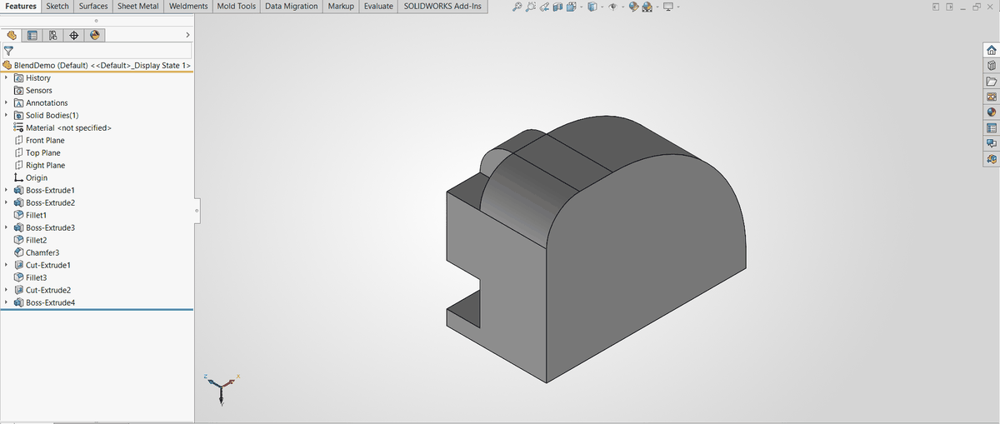
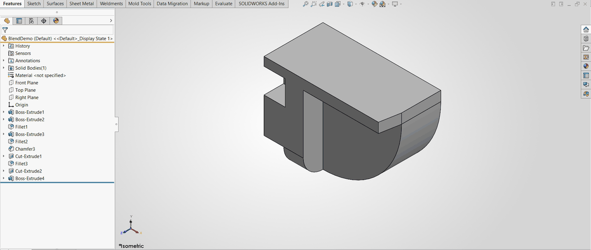

# SOLIDWORKS Custom Features

SOLIDWORKS 2026 add-in (C#, .NET Framework 4, x64) that hosts custom features under **Insert > Custom-Features**.

## CNC Chamfer

Straight edge: size and chamfer angle.

A tangent chain of edges (Tangent propagation).

Tool diameter, tip offset and reverse direction.

A chamfer that can actually be machined with a chamfer mill (default 45 deg chamfer = 90 deg mill; the mill angle is 180 deg minus twice the chamfer angle):
- Straight convex edges at any angle between the faces, with a chamfer distance (on the mill's face) and a chamfer angle.
- Circle and arc edges of holes, bosses and pocket corners (planar face + coaxial cylinder / cone); select a whole tangent chain of lines and arcs and the tools meet exactly at the joints. The mill axis follows the circle, so the chamfer is a cone.
- Ends that run into a wall stop at tool radius + clearance and finish with the cone the chamfer mill leaves.
- Per-edge tool direction (Reverse direction).
- Tip offset: moves the mill's apex below the chamfer's lower edge along the chamfer line (the chamfer itself is unchanged; only the mill's footprint at ends and corners changes). Not available at a corner where an arc runs into a wall.
- Corner blends where a rim arc meets an edge that rises from its face: another arc (e.g. a rounded pocket corner) or a straight edge, including a drafted (leaning) wall. The rim ends flush and the rising edge closes with the mill's corner cone. Reverse direction still applies to these edges.
- Blend the chamfers around an inside corner (radius = chamfer distance; any chamfer angle, any corner angle).
- Optional flat corner where three chamfers meet (like the native Chamfer; any chamfer angle and corner angles).
- Live native-style preview (in a section view only the outline strokes are drawn), edit, Ctrl+C / Ctrl+V of the feature settings.

## DIN 509 Undercut

Relief grooves (undercuts) at a shoulder, per DIN 509:2006-12, for shafts and bores. Pick the circular edge where the shaft or bore meets the shoulder (the inner corner), then the form and size:
- Forms E, F, G and H with the flank angles of the standard (E has a square wall, F leans the wall 8 deg, G and H are the large-angle forms). The wall flank runs tangentially into the corner arc, the shaft flank is a straight line (15 deg, 17.5 deg for G) out to the surface, and the corner between the wall and the arc is filled so there is no small step.
- The size list (radius x depth, with the standard's series and "higher load" variants) is filtered by the diameter d1 as in Table 1; for bores the same values are used by analogy. The recess into the shoulder wall (t2) is measured at the deepest point of the corner arc. The manufacturing allowances z1 / z2 are not modelled.
- Shaft or bore is detected from the picked edge; a bore groove goes outward into the material.
- Live native-style preview (the cut part with yellow outline and hatch strokes on the new faces; in a section view only the strokes are drawn). Pressing OK on a choice that cannot be built (an arc such as a pocket corner, the end of a shaft, a groove too big for the bore) keeps the page open and shows a tip.
- Edit definition keeps the form and size. Ctrl+C on an undercut (tree item or one of its faces) remembers its form and size; Ctrl+V with one shoulder edge selected adds the same undercut there.

## Install
**From a release:** download `CustomFeatures-vX.Y.Z.zip` from the GitHub Releases page, extract it to a permanent folder
(the add-in is registered from that location), close SOLIDWORKS and run `install.bat` (asks for administrator rights).
In SOLIDWORKS the add-in is listed as **Custom-Features** in Tools > Add-Ins.

**From source:** close SOLIDWORKS and run `install.bat` in the repository. It builds `out\CustomFeatures.dll`
(needs the Visual Studio C# compiler and the SOLIDWORKS API redist) and registers it.

`uninstall.bat` removes the registration. Requires SOLIDWORKS 2026 (x64).

## Development
`build.bat` only rebuilds the DLL (SOLIDWORKS must be closed, it locks the DLL);
`dev.ps1` closes SOLIDWORKS, rebuilds and restarts it. Test parts are in `test\`.

Source layout: `src\Core` (add-in host and the feature base classes), `src\Geometry` (shared geometry helpers), `src\Features\<Name>` (one folder per feature, currently CncChamfer and Din509). To add a feature see [docs/adding-new-feature.md](docs/adding-new-feature.md).
