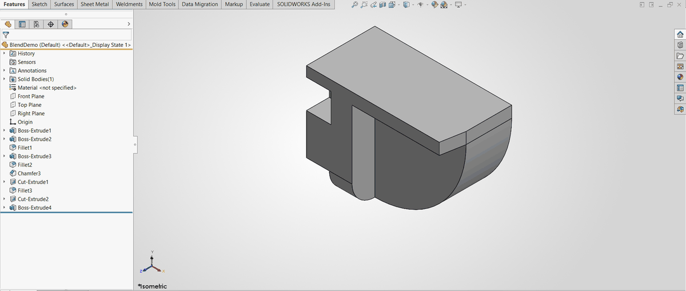

# SOLIDWORKS Custom Features

SOLIDWORKS 2026 add-in (C#, .NET Framework 4, x64) that hosts custom features under **Insert > Custom-Features**.

## CNC Chamfer

A chamfer that can actually be machined with a chamfer mill (default 45 deg chamfer = 90 deg mill; the mill angle is 180 deg minus twice the chamfer angle):
- Straight convex edges at any angle between the faces, with a chamfer distance (on the mill's face) and a chamfer angle.
- Circle and arc edges of holes, bosses and pocket corners (planar face + coaxial cylinder / cone); select a whole tangent chain of lines and arcs and the tools meet exactly at the joints. The mill axis follows the circle, so the chamfer is a cone. Reverse direction does not apply to circle edges.
- Ends that run into a wall stop at tool radius + clearance and finish with the cone the chamfer mill leaves.
- Per-edge tool direction (Reverse direction).
- Blend the chamfers around an inside corner (radius = chamfer distance; any chamfer angle, any corner angle).
- Optional flat corner where three chamfers meet (like the native Chamfer; any chamfer angle and corner angles).
- Live native-style preview, edit, Ctrl+C / Ctrl+V of the feature settings.

## Install
**From a release:** download `CustomFeatures-vX.Y.Z.zip` from the GitHub Releases page, extract it to a permanent folder
(the add-in is registered from that location), close SOLIDWORKS and run `install.bat` (asks for administrator rights).
In SOLIDWORKS the add-in is listed as **Custom-Features** in Tools > Add-Ins.

**From source:** close SOLIDWORKS and run `install.bat` in the repository. It builds `out\CustomFeatures.dll`
(needs the Visual Studio C# compiler and the SOLIDWORKS API redist) and registers it.

`uninstall.bat` removes the registration. Requires SOLIDWORKS 2026 (x64).

## Development
`build.bat` only rebuilds the DLL (SOLIDWORKS must be closed, it locks the DLL);
`dev.ps1` closes SOLIDWORKS, rebuilds and restarts it. Test parts are in `test\`.
